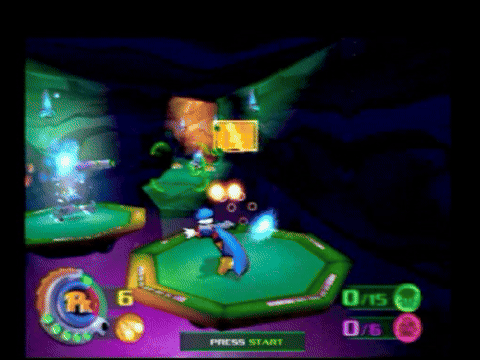

# pk-decomp

A matching decompilation of Disney's PK: Out of the Shadows (PlayStation 2, Ubi Soft Casablanca, 2002), targeting the European release SLES-50773, sold as Disney's Donald Duck PK (executable `SLES_507.73`).

<table>
<tr>
<td><br>Title screen of the European release in PCSX2.</td>
<td><br>Attract-mode demo of the European release in PCSX2.</td>
</tr>
</table>

The full retail executable rebuilds byte for byte from C, C++ and assembly. The project reconstructs matching source code and documents how the engine and the game work.

## At a glance

- **5,762 of 6,550 game functions in C and C++** (87.97%), covering 1,179,596 of 1,984,640 game code bytes (59.44%). [Progress data](docs/progress/progress.json)
- **214 function names with evidence**. The count includes entries marked `type:func` with an evidence comment, excluding `func_<address>` placeholders. [European symbol list](config/eu/symbol_addrs.txt)
- **3 CodeWarrior PS2 builds and 15 compiler profiles**. The matching profiles use builds 3.0, 3.0.1 and 3.0.3. [Compiler profiles](config/mwcc_profiles.txt)
- **7 findings and 9 open questions** about the code, the retail builds and what remains to be checked in play. [Findings](docs/discoveries.md) · [Open questions](docs/mysteries.md)

## Progress

[](docs/progress/codemap.svg)

The map lays out the code in address order, one row per 32 KB. It colours matched C and C++ functions, runs of assembly and library code. Download the SVG and open it directly in a browser to see each matched function's address and size on hover.

The Sony SDK and C runtime sit in fixed address ranges, estimated once from alignment, SDK tags and syscall stubs; the progress tool counts the 1,212 functions inside them separately from the game code. The build links most of the library functions from assembly split from the retail executable. Three stubs are rebuilt from C and fall outside the tooling licence. The SDK distributions and compiler kits stay outside the repository.

The full split has 7,762 functions and 2,203,184 code bytes. [Progress tool](tools/progress.py) · [Progress data](docs/progress/progress.json)

Regenerate the map and counts after a passing build with `.venv/bin/python -I tools/progress.py --map docs/progress`.

## Highlights from the findings

- Function names from the GameCube release help identify the same code on PS2. [The shared code base](docs/discoveries.md#-the-ps2-and-gamecube-versions-share-a-code-base)
- Most of the engine is written in C, and its sound engine uses C++. [Engine and library code](docs/discoveries.md#-the-engine-is-mostly-c-with-a-c-sound-engine)
- The European executable contains code from three builds of the same compiler. [Compiler builds](docs/discoveries.md#-three-compiler-builds-in-one-executable)
- Older compiler builds pad short loops to eight instructions, and a later build pads them to seven. [Short loops](docs/discoveries.md#-short-loops-are-padded)
- A dozen debug messages preserve the names of the functions that print them. [Debug messages](docs/discoveries.md#-debug-messages-name-the-functions-that-print-them)

## Where to read

| Page | What it holds |
| --- | --- |
| [docs/discoveries.md](docs/discoveries.md) | What the code and build reveal, with the evidence folded under each finding |
| [docs/mysteries.md](docs/mysteries.md) | Nine open questions about versions, game rules and unused content |
| [docs/community-knowledge.md](docs/community-knowledge.md) | Published observations and claims, with their sources |
| [disks/README.md](disks/README.md) | Supported disc dumps, Redump hashes and extraction commands |
| [LICENSING.md](LICENSING.md) | Which files are covered by the tooling licence |

## Building

You need x86-64 Linux, glibc 2.38 or newer for the unpacked binutils (or installed `mipsel-linux-gnu` binutils with R5900 support), GNU Make, Git, curl, `ar`, `cpp`, Python 3.11 or newer with `venv`, and your own dump of the European disc. Place the dump at `disks/pk-eu.bin`. [Disc formats and hashes](disks/README.md)

Run from the repository root. Let `make split` finish before starting the build.

```sh
git config core.hooksPath tools/hooks
tools/setup.sh    # Install the pinned toolchain and Python dependencies
make check-disk   # Verify the disc, extract it and check the retail executable
make split        # Generate assembly and linker inputs
make check        # Rebuild and compare the executable with the retail SHA-1
```

A passing `make check` prints `build/eu/SLES_507.73: OK`. [Makefile](Makefile)

### Matching a function

After splitting, use `asm` to see the assembly, `m2c` to get a draft via `cpp`, and `diff` to compare compiled source with the retail bytes. The build links matched functions at their retail addresses. A source file can select a kit and flags with `/* profile: NAME */` in its first five lines. [Function matcher](tools/fmatch.py) · [Compiler profiles](config/mwcc_profiles.txt)

```sh
.venv/bin/python -I tools/fmatch.py asm func_0029B920
.venv/bin/python -I tools/fmatch.py m2c func_0029B920
.venv/bin/python -I tools/fmatch.py diff func_0029B920 src/text_2810d0/func_0029B920.c
```

For a new match, pass a source file named after the function to `.venv/bin/python -I tools/integrate.py`. It adds the file under `src/` and runs `make check`. [Integration tool](tools/integrate.py)

## How it was made

AI agents wrote the C, the names and the docs, mostly GPT-6.2 Sol (high) and Claude Opus 5.5 (high). A change was kept only when `make check` still matched.

## Legal

This is an independent fan project with no affiliation with Disney or Ubi Soft. It ships no executable, disc data, audio, game text or images beyond the two small emulator screenshots above. You need your own disc to build it. Setup fetches commercial Metrowerks CodeWarrior compiler kits for local use, and the kits are never committed. A takedown request from the rights holder will be honored.

The project's original tooling is MIT-licensed as listed in the licensing file, with reconstructed game code, data and screenshots outside its scope and third-party notices in a separate file. [Licensing](LICENSING.md) · [Third-party notices](THIRD_PARTY_NOTICES.md)

## Credits

Built with splat, spimdisasm, rabbitizer, m2c, decomp-permuter, asm-differ, objdiff, wibo, GNU binutils, pycdlib and decomp.me's compiler kits. The screenshots were taken in PCSX2.

The GameCube release's symbol table provides evidence for PS2 function names. Community sources include The Cutting Room Floor, Redump, Hidden Palace, Raymap, the RaymanPC forum, Wikipedia and Neoseeker. [Naming evidence](config/eu/symbol_addrs.txt) · [Community findings](docs/community-knowledge.md)

`include/macro.inc` is splat's generated file (MIT, Copyright (c) 2021 Ethan Roseman). [Third-party notices](THIRD_PARTY_NOTICES.md)
