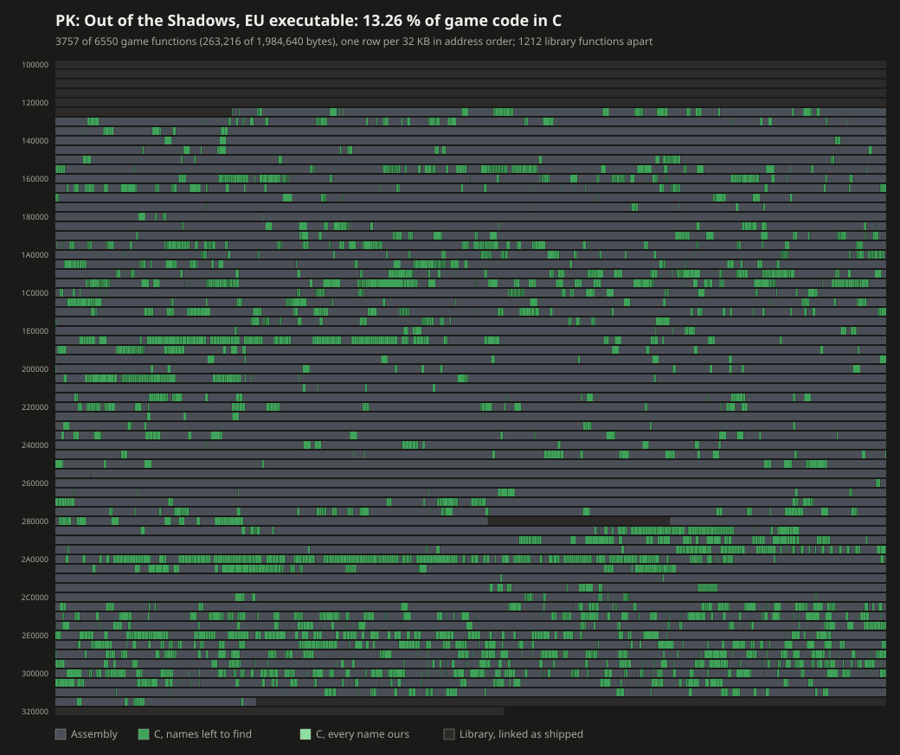
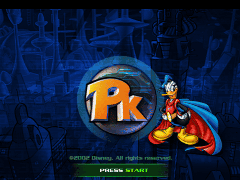

# pk-decomp

A matching decompilation of the 2002 PlayStation 2 game Disney's PK: Out of the Shadows, released in Europe as Disney's Donald Duck PK. The European executable (`SLES_507.73`) rebuilds byte for byte from C, C++ and assembly.

Matching C and C++ cover 5,762 of 6,550 game functions (87.97%) and 59.44% of game code bytes. These figures exclude the Sony SDK and runtime libraries. [Progress data](docs/progress/progress.json)

## Build and check

Use x86-64 Linux (glibc 2.38 or newer for the MIPS binutils `tools/setup.sh` unpacks, or an installed `mipsel-linux-gnu` binutils with R5900 support) with GNU Make, Git, curl, `ar`, `cpp` (the C preprocessor, for `fmatch.py m2c`), Python 3.11 or newer with `venv` and your own dump of the European game disc. Place the dump at `disks/pk-eu.bin`. [Disc formats and hashes](disks/README.md)

No game data is in this repository beyond the two small screenshots below: the build needs your own disc. The compiler, Metrowerks CodeWarrior for PS2, is commercial; `tools/setup.sh` fetches decomp.me's compiler kits into `tools/mwcc/` for local use, and they are never committed. Third-party licence notices: [THIRD_PARTY_NOTICES.md](THIRD_PARTY_NOTICES.md).

Run from the repository root.

```sh
tools/setup.sh    # Install the pinned toolchain and Python dependencies
make check-disk   # Verify the disc hash, extract the disc and check the retail executable
make split        # Generate assembly and linker inputs
make check        # Build and verify the full executable against the retail SHA-1
```

Wait for `make split` to finish before starting a build. The executable is written to `build/eu/SLES_507.73`. [Makefile](Makefile)

## How matching works

The build compiles C and C++ with Metrowerks CodeWarrior for PS2, then links those functions at their retail addresses alongside the remaining assembly. A source file can select a compiler kit and flags with a `/* profile: NAME */` comment in its first five lines. [Compiler profiles](config/mwcc_profiles.txt)

After splitting the executable, try the matcher on this function. `asm` writes out the assembly, `m2c` prints a draft using the system C preprocessor (`cpp`), and `diff` compares the compiled source with the retail bytes. [Function matcher](tools/fmatch.py)

```sh
.venv/bin/python -I tools/fmatch.py asm func_0029B920
.venv/bin/python -I tools/fmatch.py m2c func_0029B920
.venv/bin/python -I tools/fmatch.py diff func_0029B920 src/text_2810d0/func_0029B920.c
```

For a new match, pass a source file named after the function to `.venv/bin/python -I tools/integrate.py`. The script adds it to `src/` and runs `make check`. Enable the repository's commit hooks with `git config core.hooksPath tools/hooks` before committing. [Integration tool](tools/integrate.py)

## Research

- [Community findings](docs/community-knowledge.md) records earlier reports and their sources.
- [Decompilation findings](docs/discoveries.md) documents evidence from the game binaries and compiler tests.
- [Open questions](docs/mysteries.md) lists what remains to investigate.

## Executable map and screenshots



Regenerate the map and progress data after a passing build with `.venv/bin/python -I tools/progress.py --map docs/progress`. [Progress tool](tools/progress.py)

 

*The European release in PCSX2.*
